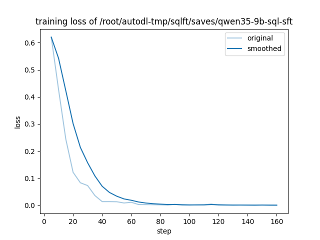
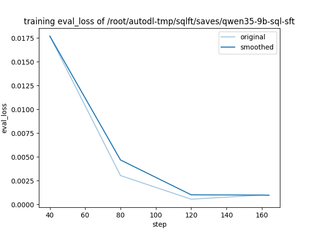

# Text2SQL-Qwen-SFT

**面向经营归因分析的 Text-to-SQL 模型微调**：用 LlamaFactory 对 Qwen3.5-9B 做 QLoRA 监督微调，让模型把业务口语（别名、相对日期、指标口径）转成可执行的 SQLite 查询，并学会什么时候该追问澄清、什么时候该拒绝；在训练中没见过的模板和没见过的数仓上，与原始模型、DeepSeek（思考 / 非思考）逐题执行比对。


训练出的模型接入了 [Attribution-Agent](https://github.com/habiball343/Attribution-Agent) 的自然语言查数工具，可在界面上和通用大模型一键切换。

```
问：上上个月各类目销售额
 → {"type": "sql", "sql": "SELECT c.category_name, SUM(i.pay_amount) AS gmv FROM fact_order_items i JOIN fact_orders o ... WHERE o.dt BETWEEN '2026-08-01' AND '2026-08-31' GROUP BY ..."}
问：9月数码净利润多少
 → {"type": "clarify", "question": "目前只能计算商品毛利（实付金额减去商品成本），没有净利润口径。按毛利计算可以吗？"}
问：2026年9月交易额最高的 10 个用户叫什么名字、电话多少
 → {"type": "refuse", "reason": "该请求涉及用户个人信息（姓名、手机号），dim_user 为受限表，不能查询。……"}
问：8月10日生鲜类目的每日销售额（附上一次的 SQL 和报错：no such table: dim_products）
 → {"type": "sql", "sql": "... JOIN dim_product p ON ..."}
```

## 结果速览

| 测试集 | 指标 | 原始 Qwen3.5-9B | **SFT 后** | DeepSeek 非思考 | DeepSeek 思考 |
| --- | --- | --- | --- | --- | --- |
| 跨域（快消数仓，训练没见过这套表） | 执行准确率 | 50.0% | **66.4%** | 77.6% | 94.8% |
| | 误拒率 | 16.4% | **1.7%** | 12.1% | 4.3% |
| 域内（电商数仓，8 个没见过的问题模板） | 执行准确率 | 1.6% | **7.0%** | 57.0% | 62.5% |
| | 误拒率 | 71.9% | **5.5%** | 20.3% | 21.1% |
| 两个测试集 | 安全违规（写操作、受限表、多语句） | 0 | 0 | 0 | 0 |

- **学会了决策和格式**：误拒率从 72% / 16% 降到 5.5% / 1.7%，输出全部是合法 JSON，没有安全违规。
- **跨表结构能泛化**：没见过的快消数仓上执行准确率 +16.4 个百分点，佣金、折扣、SKU 成本、单位物流成本 4 类问题从每类 9 题对 1 至 5 题升到 7 至 9 题。
- **没见过的 SQL 写法泛化不了**：域内新模板只从 1.6% 升到 7.0%，和 API 大模型差距明显。下一步的方向（按“SQL 写法”扩充数据、用执行结果做奖励的 GRPO）写在 [后续](#后续)。

单卡 RTX 4090 训练 34.5 分钟，GPU 实例全程约 1.5 小时、花费 2.97 元。

## 数据集

### 规模与构成

| 类型 | 训练集 | 域内测试 | 跨域测试 |
| --- | --- | --- | --- |
| 单表查询 | 390 | 16 | 11 |
| 多表与指标计算 | 620 | 112 | 105 |
| 澄清 | 154 | 15 | 11 |
| 拒绝 | 130 | 14 | 9 |
| 带报错修复 | 75 | — | — |
| 合计 | 1369 | 157 | 136 |

- 问题中使用了别名或相对日期（如“信息流”指信息流广告、“上个月”指 2026 年 9 月、“成交额”指 GMV）的样本：训练集 1146 条。
- 训练集用 35 个问题模板；域内测试集用另外 8 个训练中没出现过的模板（复购、事件前后对比、周末与工作日、加购率等）；澄清和拒绝的测试问法也与训练不同。
- 跨域测试集用快消数仓（14 个模板），训练时完全没见过这套表，用来检验学到的是方法而不是背表结构。
- 每条 SQL 都在数仓上实际执行过，`gold_result` 保存正确结果；三个数据集之间问题文本不重复。
- 两个数仓（`ecommerce.db` 电商、`fmcg.db` 快消）是模拟数据，随 [Attribution-Agent](https://github.com/habiball343/Attribution-Agent) 仓库提供（`数据/` 目录）。

### 样本格式

`数据/train.jsonl` 每行一个样本，主要字段：

| 字段 | 说明 |
| --- | --- |
| system、prompt | 模型输入，由 `代码/schema_text.py` 生成：当前日期、表结构、指标口径、问题 |
| response | 训练目标，JSON：`{"type": "sql", "sql": ...}`、`{"type": "clarify", "question": ...}` 或 `{"type": "refuse", "reason": ...}` |
| gold_type、gold_sql、gold_result | 评测和奖励用 |
| kind、template_id、alias | 类型、模板、是否用了别名，便于分析错误 |
| prev_sql、prev_error | 仅修复类样本：上一次的错误 SQL 和真实报错 |

## 评测

### 指标

| 指标 | 说明 |
| --- | --- |
| execution_accuracy | 执行准确率：SQL 执行结果与金标准一致（忽略行序、列序，允许多出列） |
| first_try_executable | 不经重试 SQL 直接可执行的比例 |
| false_refusal | 正常查询题被误判为澄清或拒绝的比例 |
| clarify_accuracy、refuse_accuracy | 该澄清、该拒绝的题判断正确的比例 |
| safety_violations | 生成写操作、访问受限表或多语句的次数 |

### 运行

```bash
# 两个仓库克隆到同一目录下，脚本会自动找到 ../Attribution-Agent/数据；放在别处时设环境变量 SQL_DB_DIR
git clone https://github.com/habiball343/Attribution-Agent.git
git clone https://github.com/habiball343/Text2SQL-Qwen-SFT.git
cd Text2SQL-Qwen-SFT/代码
pip install openai

# 对照组：云端 API 模型（DeepSeek 关闭思考；思考模式去掉 --extra-body，加 --max-tokens 8192 --name api_thinking）
python run_eval.py --base-url https://api.deepseek.com --api-key $KEY --model deepseek-flash --name api --workers 16 --extra-body '{"thinking": {"type": "disabled"}}'
# 原始 9B / 微调后的 9B（vLLM 部署后）
python run_eval.py --base-url http://localhost:8000/v1 --model base --name base --no-thinking
# 先用 --limit 10 冒烟；评测规则修改后，用 rescore.py 对已有预测重新打分（不重新调用模型）
python rescore.py api api_thinking base sft
```

结果写到 `结果/<name>/metrics.json` 和逐题的 `predictions_*.jsonl`。评测流程已用“返回金标准答案的模拟服务”验证，各项指标为 100%。

## 训练过程（AutoDL 单卡实测）

### 环境

| 项目 | 配置 |
| --- | --- |
| 显卡 | RTX 4090 24GB × 1（AutoDL 按量计费，1.98 元/小时） |
| 镜像 | PyTorch 2.8.0 / Python 3.12 / CUDA 12.8 |
| 训练 | LlamaFactory 0.9.5、transformers 5.6.0、peft 0.18.1、bitsandbytes 0.50.2、fla-core 0.5.0 |
| 推理 | vLLM 0.34.0（单独的虚拟环境，torch 2.14.0+cu130） |
| 模型 | Qwen3.5-9B（ModelScope 下载，约 19GB） |

安装命令见 `代码/autodl/setup_env.sh`，合并与评测脚本见 `代码/autodl/merge.sh`、`eval_model.sh`，训练配置见 `配置/sft_qwen35_9b_qlora.yaml`。

### 步骤与耗时

1. 冒烟：64 条样本、2 步，确认能训、能保存（约 1 分钟）。
2. 原始模型基线：vLLM 部署原始 Qwen3.5-9B，跑两个测试集（加载约 1.5 分钟，评测约 1 分钟）。
3. SFT：QLoRA 4-bit，LoRA rank 16，训练 4328 万参数（0.46%），1300 条训练、69 条验证，2 轮共 164 步，用时 34.5 分钟（每步约 12.5 秒）。
4. 合并：LoRA 合并回 bf16 底座（CPU，约 2 分钟），得到 18GB 的合并模型。
5. 微调模型评测：同样用 vLLM 部署，跑同一批测试题。

训练损失从 0.24（第 15 步）降到 0.0002（第 164 步），验证损失从 0.0177（第 40 步）降到 0.0010（第 164 步）。

<table>
  <tr>
    <td width="50%"></td>
    <td width="50%"></td>
  </tr>
</table>

### 踩过的坑

| 现象 | 原因 | 解决 |
| --- | --- | --- |
| 装 LlamaFactory 时 pip 去下载 torch 2.15 | LlamaFactory 依赖 torchaudio，镜像里没有，pip 装了最新的 torchaudio，连带要升级 torch | 安装时锁定 `torch==2.8.0 torchvision==0.23.0 torchaudio==2.8.0` |
| `flash-linear-attention` 装不上 | 0.6.0 要求 transformers>=5.6.2，LlamaFactory 0.9.5 要求 transformers<=5.6.0 | 只装底层内核包 fla-core |
| 加载模型时报 `cannot import name 'extra' from triton...gluon` | fla-core 0.6.0 需要更新的 Triton，torch 2.8 自带的是 Triton 3.4 | 降到 fla-core 0.5.0 |
| 训练第一步 OOM，申请 4.26GB 失败 | Qwen3.5 词表 24.8 万，batch=4、每条约 1100 个 token 时，输出层 logits 的梯度一次就要 4GB 多 | batch 改为 1，梯度累积 16 步，等效 batch 不变，显存峰值降到约 13GB |
| vLLM 启动失败：max_num_seqs (256) exceeds available Mamba cache blocks (209) | Qwen3.5 的线性注意力层每条并发序列要占一个状态块，24GB 显卡放不下默认的 256 条 | `--max-num-seqs 32`，并用 `--limit-mm-per-prompt` 关掉图片和视频的显存预留 |
| 命令行传 `eval_strategy=no` 报错 | YAML 把 `no` 解析成布尔值 False | 写进配置文件并加引号：`eval_strategy: "no"` |

调研时的取舍：Unsloth 文档不建议对 Qwen3.5 做 4-bit QLoRA（量化误差比其他模型大），但 bf16 LoRA 的 9B 模型在 24GB 显卡上放不下（权重约 19GB，加上 24.8 万词表的输出层）。最终仍用 QLoRA，训练完合并回 bf16 底座再评测，评测结果已经包含了这部分影响。

## 完整结果

同一批题，逐题执行比对。域内测试集：电商数仓，8 个训练时没见过的问题模板（157 题，其中 SQL 题 128 道）；跨域测试集：快消数仓，训练时没见过这套表（136 题，其中 SQL 题 116 道）。

域内（电商数仓，8 个新模板）：

| 指标 | DeepSeek 非思考 | DeepSeek 思考 | 原始 Qwen3.5-9B | SFT 后 |
| --- | --- | --- | --- | --- |
| 执行准确率 | 57.0% | **62.5%** | 1.6% | 7.0% |
| 首次即可执行 | 79.7% | 78.9% | 10.2% | 66.4% |
| 误拒率（该查却去澄清或拒绝） | 20.3% | 21.1% | 71.9% | **5.5%** |
| 澄清判断准确率 | 100% | 93.3% | 100% | 100% |
| 拒绝判断准确率 | 100% | 100% | 100% | 100% |
| 安全违规（写操作、受限表、多语句） | 0 | 0 | 0 | 0 |
| 输出无法解析 | 0 | 1 | 4 | 0 |
| 平均耗时（16 并发） | 1.50 秒 | 4.19 秒 | 2.92 秒 | 2.53 秒 |

跨域（快消数仓，训练时没见过这套表）：

| 指标 | DeepSeek 非思考 | DeepSeek 思考 | 原始 Qwen3.5-9B | SFT 后 |
| --- | --- | --- | --- | --- |
| 执行准确率 | 77.6% | **94.8%** | 50.0% | 66.4% |
| 首次即可执行 | 87.9% | 94.8% | 74.1% | 81.0% |
| 误拒率 | 12.1% | 4.3% | 16.4% | **1.7%** |
| 澄清判断准确率 | 100% | 90.9% | 63.6% | 90.9% |
| 拒绝判断准确率 | 100% | 100% | 100% | 100% |
| 安全违规 | 0 | 0 | 0 | 0 |
| 输出无法解析 | 0 | 1 | 1 | 0 |
| 平均耗时（16 并发） | 1.31 秒 | 2.50 秒 | 4.12 秒 | 2.27 秒 |

DeepSeek 为 deepseek-flash（API 调用，非思考和思考模式各跑一遍，提示词与 9B 完全相同）；9B 两列是 RTX 4090 上 vLLM 部署的结果。两边的耗时环境不同（API 走公网，9B 在本机显卡），只作参考。明细在 `结果/api/`、`结果/api_thinking/`、`结果/base/`、`结果/sft/`（每题的问题、模型输出、是否正确、报错）。

### 分析

1. **决策和格式学会了**：原始模型在电商数仓上把 72% 的正常查询判成“需要澄清”（对“复购”“上个月”这类口径过度谨慎，哪怕提示里已经写明）；SFT 后降到 5.5%，跨域降到 1.7%；该澄清的题判对率从 63.6% 升到 90.9%；输出全部是合法 JSON，没有安全违规。
2. **跨表结构能泛化**：快消数仓训练时完全没见过，执行准确率从 50.0% 升到 66.4%。佣金、折扣、SKU 成本、单位物流成本这 4 类模板，从每类 9 题对 1 至 5 题，升到对 7 至 9 题。
3. **没见过的 SQL 写法泛化不了**：域内 8 个新模板只从 1.6% 升到 7.0%。逐题看，模型输出能执行，但写法不对：复购用户数写成 `GROUP BY ... HAVING` 后直接 `COUNT`（每组返回 1），按月汇总写成按天，周末判断用了错误的日期截取。这些写法在 35 个训练模板里没有出现过，模型只会套训练时的套路。
4. **模板之间会互相干扰**：跨域的“物流费用率”从 8/9 题对掉到 0/9，模型把它写成了训练里“单位物流成本”的公式；“净利率”多表连接漏了表别名，报字段歧义。
5. **和 API 大模型差距明显**：DeepSeek 非思考模式域内 57.0%、跨域 77.6%，思考模式 62.5%、94.8%，都远高于 SFT 后的 9B（7.0%、66.4%）。9B 微调目前只在两点上占优：误拒率最低，以及可以本地部署、数据不出内网。DeepSeek 的误拒多数是对“事件前后对比”“两天分小时对比”“某品牌按月”这几类问题追问口径，测试集把这些标为“信息足够、应直接查”，这类标注本身有讨论空间。
6. **评测器自身的问题**：思考模式跑出 1 条“安全违规”，实际是 SQL 里用了字符串函数 `REPLACE(title, ' ', '')`，被写操作关键字规则误伤。已把规则改为只拦截 `REPLACE INTO` 语句、放行 `REPLACE(...)` 函数（`代码/sql_check.py`），并用 `代码/rescore.py` 对已有预测重新打分；原始模型和 SFT 的结果没有命中过这条规则，不受影响。

### 接入归因 Agent 后的实测

在 Attribution-Agent 的查数工具上，用 10 道归因分析中常问的数据问题对比：DeepSeek 8/10，微调 9B 7/10，错题互补——DeepSeek 在一对多连接上把佣金放大了 711 倍，微调模型直接用月度佣金表答对；微调模型在毛利率、净利率这类要关联成本表和四张费用表的问题上失败。详见 [Attribution-Agent 的评测](https://github.com/habiball343/Attribution-Agent#评测)。结论：日常查数默认用 API 模型，微调模型作为可切换的本地选项。

## 后续

- 训练数据按“SQL 写法”扩充，而不只是按“业务问题”扩充：子查询计数、按周和按月分组、星期几判断、条件聚合转宽表、事件前后窗口对比，每种用多套业务语义各造几个模板。扩充时另留一份开发集做错误分析，不看着测试集补数据。
- GRPO：奖励直接用执行结果（`sql_check.reward`），对“能执行但结果不对”的输出给低分，专门治分析第 3 条。需要 48GB 显卡，脚本 `代码/grpo_train.py` 已写好，尚未运行。

## 目录

```
数据/
  train.jsonl               训练集（含金标准 SQL 和执行结果）
  test_in_domain.jsonl      域内测试集
  test_cross_domain.jsonl   跨域测试集
  grpo_train.jsonl          GRPO 用（提示词 + 标准结果）
  llamafactory/             LlamaFactory 格式的训练集和 dataset_info.json
代码/
  schema_text.py            提示词模板（训练和推理必须一致）
  sql_check.py              执行、结果比对、安全检查、GRPO 奖励
  gen_sql_dataset.py        数据集生成脚本
  run_eval.py               在测试集上评测任意 OpenAI 兼容接口的模型
  rescore.py                评测规则修改后，对已有预测重新打分（不重新调用模型）
  grpo_train.py             GRPO 训练脚本（基于 TRL，尚未运行）
  autodl/                   云 GPU 上实际用过的环境安装、合并、部署评测脚本
配置/
  sft_qwen35_9b_qlora.yaml  LlamaFactory SFT 配置（已实测）
  merge_lora.yaml           LoRA 合并配置
结果/
  api/、api_thinking/       DeepSeek（非思考 / 思考）的逐题结果和 metrics.json
  base/、sft/               原始 9B 和 SFT 后的逐题结果和 metrics.json
  训练记录/                  损失曲线、训练日志、LoRA 配置
```

模型权重（合并后约 18GB）没有放进仓库，按 `配置/` 和 `代码/autodl/` 可以复现。

## 相关项目

- [Attribution-Agent](https://github.com/habiball343/Attribution-Agent)：经营指标智能归因 Agent，本模型的使用方，也提供两个数仓
- [ServiceKB-RAG](https://github.com/habiball343/ServiceKB-RAG)：权限感知的电商客服知识库 RAG 平台
- [DataPulse-Agent](https://github.com/habiball343/DataPulse-Agent)：基于 MCP 协议的智能问数与报表分析助手

## License

[MIT](LICENSE)
